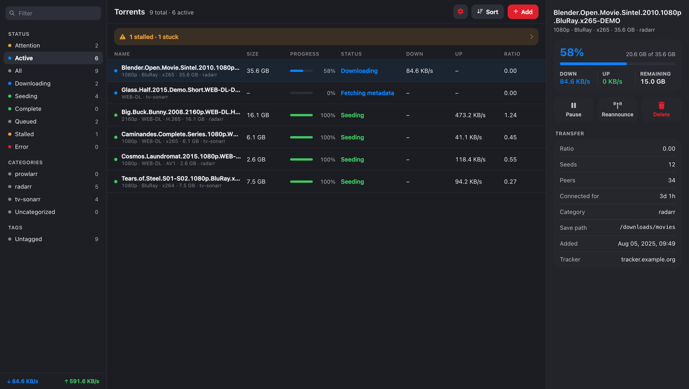
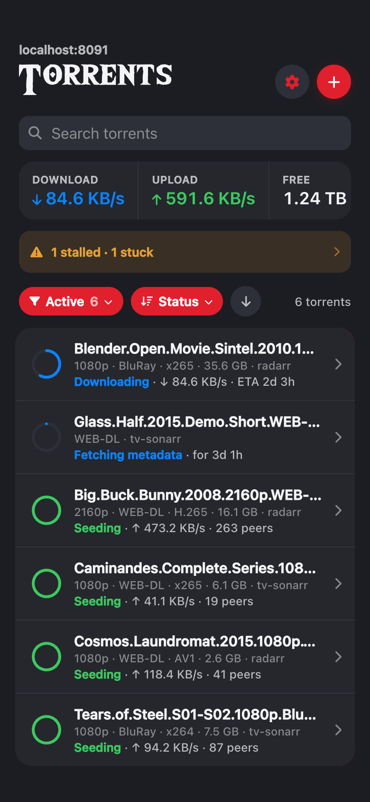
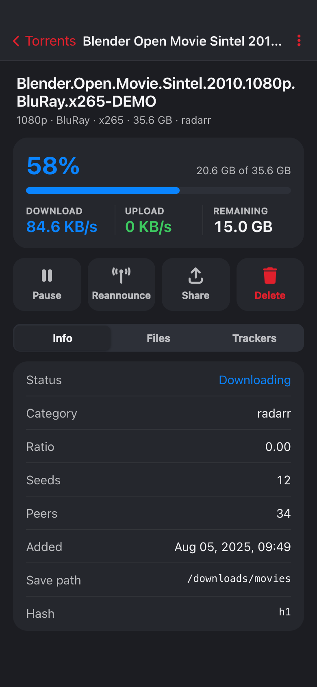
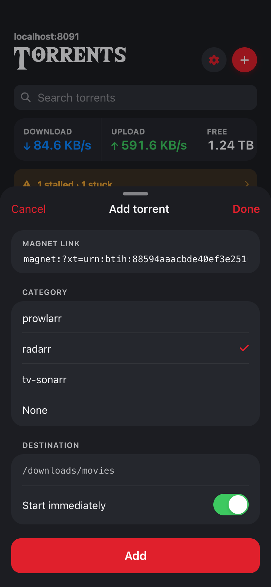
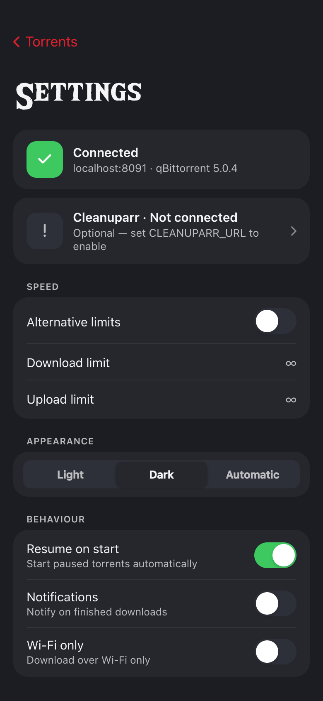

# qbit-ember

A hand-built, mobile-first web UI for [qBittorrent](https://www.qbittorrent.org/) — a
replacement for the stock WebUI. Dark theme with a red accent ("Modern Dark + Red"),
iOS-style navigation, and a desktop layout with sidebar + table + detail column.

Pure frontend: no backend of its own, no database. The app talks only to the official
[qBittorrent WebUI API v2](https://github.com/qbittorrent/qBittorrent/wiki/WebUI-API-(qBittorrent-4.1))
(`/api/v2/...`), mainly `sync/maindata` for delta polling on a 1.1s interval. Login goes
straight through your qBittorrent credentials.



| List | Detail | Add | Settings |
|---|---|---|---|
|  |  |  |  |

<sub>Screenshots use demo data (`tools/screenshot/`), not a real library.</sub>

## Features

- Torrent list with live search, filters, sorting and swipe actions (pause / delete)
- Detail view with progress, transfer stats, files and trackers
- Add torrents via magnet link, with category and derived save path
- Light / dark / automatic theme, installable as a PWA on iOS and Android
- Responsive: phone layout below 900px, three-column desktop above
- An attention line above the list that appears only when something needs you — errored,
  stalled or stuck torrents, low disk space, or a Cleanuparr that has gone quiet. Tapping it
  filters the list down to exactly those torrents
- Torrents waiting on metadata are called out as such instead of posing as downloads

## Stack

- Angular (standalone components, signals), TypeScript strict
- Design tokens as CSS custom properties — light/dark, see [`design/`](design/README.md)
- Font Awesome 6 Free (CDN), WildBreath display font

## Local development

`proxy.conf.json` points at a real qBittorrent instance (same-origin trick, no CORS).
Change the target to your own instance:

```json
{ "/api": { "target": "http://qbittorrent.local:8080", "changeOrigin": true } }
```

```bash
npm ci
npx ng serve        # http://localhost:4200, /api/v2/* is proxied to your instance
```

## Build & Docker

A single self-contained container: multi-stage build (Node → nginx:alpine). nginx listens
on port **8091**, serves the static build and reverse-proxies `/api/v2/` to the backend
configured via `QBIT_API_URL` (default `http://gluetun:8080`, the standard qBittorrent
WebUI port). No CORS setup required.

```bash
docker build -t qbit-ember .
docker run -p 8091:8091 -e QBIT_API_URL=http://qbittorrent.local:8080 qbit-ember
```

On push to `main` (or on `v*` tags) GitHub Actions builds a multi-arch image
(`linux/arm64` + `linux/amd64`) and pushes it to GHCR, so low-powered hosts like a
Raspberry Pi never have to build it themselves.

## Cleanuparr (optional)

[Cleanuparr](https://cleanuparr.github.io/Cleanuparr/) watches your *arr queues and removes
downloads that stall, fail to import or turn out to be junk. Connect it and qbit-ember can tell
you whether a problematic torrent is already being handled instead of leaving you guessing.

Skip this section entirely if you don't run Cleanuparr. Unconfigured, the app looks and behaves
exactly as it does without the integration — nothing is shown and nothing is polled.

### 1. Get the API key

Open your Cleanuparr web UI and copy the key from **Account settings**.

### 2. Add two environment variables

```yaml
    environment:
      - CLEANUPARR_URL=http://cleanuparr:11011
      - CLEANUPARR_API_KEY=${CLEANUPARR_API_KEY}
```

Keep the key itself out of the compose file — put it in your stack's environment (Komodo: stack
variables, plain compose: an `.env` file next to it).

`CLEANUPARR_URL` is the address **as seen from inside the container**:

| Where Cleanuparr runs | Use |
|---|---|
| Same compose stack | `http://cleanuparr:11011` (the service name) |
| A different stack, or outside Docker | `http://<host-ip>:11011` |
| Not on a Docker network at all | also set `DNS_RESOLVER` to a reachable DNS server |

No `depends_on` is needed. Unlike `QBIT_API_URL`, the Cleanuparr hostname is resolved per
request, so it may start later, restart, or be missing entirely — qbit-ember starts either way.

### 3. Check that it worked

Open **Settings**. Under the qBittorrent card sits a Cleanuparr card that names the problem
directly:

| Card says | Meaning | Fix |
|---|---|---|
| **Connected** (green) | Key and URL are good | — |
| **API key rejected** (red, HTTP 401/403) | Cleanuparr answered but refused the key | Copy the key again from Account settings into `CLEANUPARR_API_KEY` |
| **Unsupported Cleanuparr version** (red, HTTP 404) | Reached Cleanuparr, but this build has no `/api/v2/stats` | Update Cleanuparr |
| **Not reachable** (amber, HTTP 502) | It answered before and is gone now | Check the Cleanuparr container and `CLEANUPARR_URL` |
| **Not connected** (grey) | Never answered at all | Check `CLEANUPARR_URL`; grey because not running Cleanuparr is a valid choice, not a fault |

Each failure names the HTTP code it got, so a wrong key, an old version and an unreachable host
are never reported as the same problem.

Tapping the card opens a Cleanuparr screen with removed items, strikes and events for the last
24 hours plus a per-job breakdown.

### What you get

- **Settings** — the connection card above, and the Cleanuparr screen behind it
- **Torrent detail** — for any torrent Cleanuparr has touched, a card with its strike count,
  the last action, the reason and when it happened, matched on the torrent hash
- **Attention line** — a rejected key, a Cleanuparr that has gone silent, or failing jobs are
  called out above the list; a quiet line reports what it cleaned up

The key never reaches the browser: nginx injects the `X-Api-Key` header inside the container, and
the frontend only ever calls `/cleanuparr/...` on its own origin.

### Endpoints used

| Purpose | Endpoint |
|---|---|
| Aggregated stats | `GET /api/v2/stats?hours=24` |
| Per-torrent context | `GET /api/events?pageSize=200` |

Cleanuparr removed the v1 `/api/stats` endpoint; anything still calling it gets a 404. The counts
come from `events.total`, `strikes.total`, `removals.total` and `jobs.byType.*`.

### Limitations

- The strike **threshold** is not shown ("2 strikes", not "2 of 3") — Cleanuparr's events API
  reports the count but not the configured maximum.
- Per-torrent context comes from the last 200 events. With a very large library, strikes older
  than that window drop off the detail screen.

## Deployment (docker compose / Komodo)

```yaml
services:
  qbit-ember:
    image: ghcr.io/dragonmasta37070/qbit-ember:latest
    container_name: qbit-ember
    environment:
      - QBIT_API_URL=http://gluetun:8080   # qBittorrent WebUI behind Gluetun
      # optional, see the Cleanuparr section — omit both if you don't run it
      # - CLEANUPARR_URL=http://cleanuparr:11011
      # - CLEANUPARR_API_KEY=${CLEANUPARR_API_KEY}
    ports:
      - "8091:8091"
    networks:
      - gluetun-net          # same network as the gluetun container
    restart: unless-stopped
    # drop `ports` if an upstream reverse proxy (nginx) serves
    # qbit-ember:8091 on its own subdomain
```

Note: nginx resolves the `QBIT_API_URL` hostname at startup, so the `gluetun` container
has to be running before `qbit-ember` starts (`depends_on`, or stack order in Komodo).

## Design

The full high-fidelity design handoff (tokens, screens, style guide, interactive
prototypes) lives in [`design/`](design/README.md) and is the authoritative reference for
colours, components and behaviour — including for future changes.

## License

[MIT](LICENSE)
